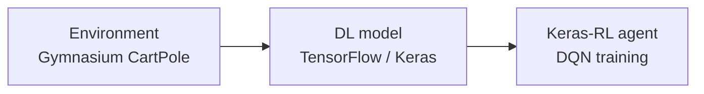

# CartPole with Deep Q-Learning (DQN)

[](https://colab.research.google.com/github/bablu2023/rl-cartpole-dqn/blob/main/notebooks/run_in_colab.ipynb)

A reinforcement learning agent that learns to balance a pole on a moving cart, built with
**Gymnasium** (environment), **TensorFlow/Keras** (deep learning model) and **keras-rl2** (DQN agent).



## The problem

| | |
|---|---|
| **State** (4 values) | cart position, cart velocity, pole angle, pole angular velocity |
| **Actions** (2) | push cart left (0) or right (1) |
| **Reward** | +1 for every step the pole stays upright |
| **Episode ends** | pole tilts > 12°, cart leaves the track, or 500 steps (CartPole-v1) |

A random agent scores about 20. The goal is to reach the maximum of 500.

## How it works

1. **Environment** (`src/env.py`): Gymnasium's CartPole, wrapped so it returns the old Gym API that keras-rl2 expects.
2. **Model** (`src/model.py`): a small neural network (4 → 24 → 24 → 2) that estimates a **Q-value**, the expected future reward, for each action.
3. **Agent** (`src/agent.py`): keras-rl2's `DQNAgent` with:
   - **Boltzmann policy**: picks actions with probability weighted by their Q-values, balancing exploration and exploitation.
   - **Replay memory** (50,000 steps): learns from random past experiences, which makes training stable.
   - **Target network** with soft updates (`target_model_update=0.01`).

## Project structure

```
rl-cartpole-dqn/
├── README.md
├── requirements.txt
├── train.py                  # train the agent, save weights + reward plot
├── evaluate.py               # load weights, test, record a video
├── src/
│   ├── __init__.py           # forces Keras 2 (tf-keras) for keras-rl2
│   ├── env.py                # environment + old-API wrapper
│   ├── model.py              # neural network
│   └── agent.py              # DQN agent
├── scripts/
│   └── patch_keras_rl.py     # fixes keras-rl2 imports for new TensorFlow
├── notebooks/
│   └── run_in_colab.ipynb    # run everything in Google Colab
└── results/                  # weights, plots, videos are saved here
```

## Run in Google Colab (easiest)

Click the **Open in Colab** badge at the top, then Runtime → Run all.

## Run locally

```bash
git clone https://github.com/bablu2023/rl-cartpole-dqn.git
cd rl-cartpole-dqn
python -m venv .venv && source .venv/bin/activate     # Windows: .venv\Scripts\activate
pip install -r requirements.txt
python scripts/patch_keras_rl.py                      # once, after installing
python train.py --steps 50000                         # ~5–10 min on CPU
python evaluate.py --episodes 20                      # prints mean reward, saves results/agent.mp4
```

## Results

After training, add your numbers and plot here:

| Agent | Mean reward (20 test episodes) |
|---|---|
| Random actions | ~20 |
| DQN (50,000 steps) | _fill in_ |


## Compatibility notes

keras-rl2 has not been updated since 2020. To run it on current TensorFlow (2.21) and Python 3.13, this project:

- uses **tf-keras** (Keras 2) via `TF_USE_LEGACY_KERAS=1`, because keras-rl2 breaks on Keras 3
- uses **Gymnasium** with a wrapper, because the original `gym` is unmaintained and doesn't support NumPy 2
- patches keras-rl2's imports of `tensorflow.python.keras` (`scripts/patch_keras_rl.py`)
- builds the model **after** importing keras-rl2, which avoids the `_compile_time_distribution_strategy` error

## Credits

Based on the "Deep Reinforcement Learning in Python" tutorial by Nicholas Renotte (2020), updated for current libraries.
